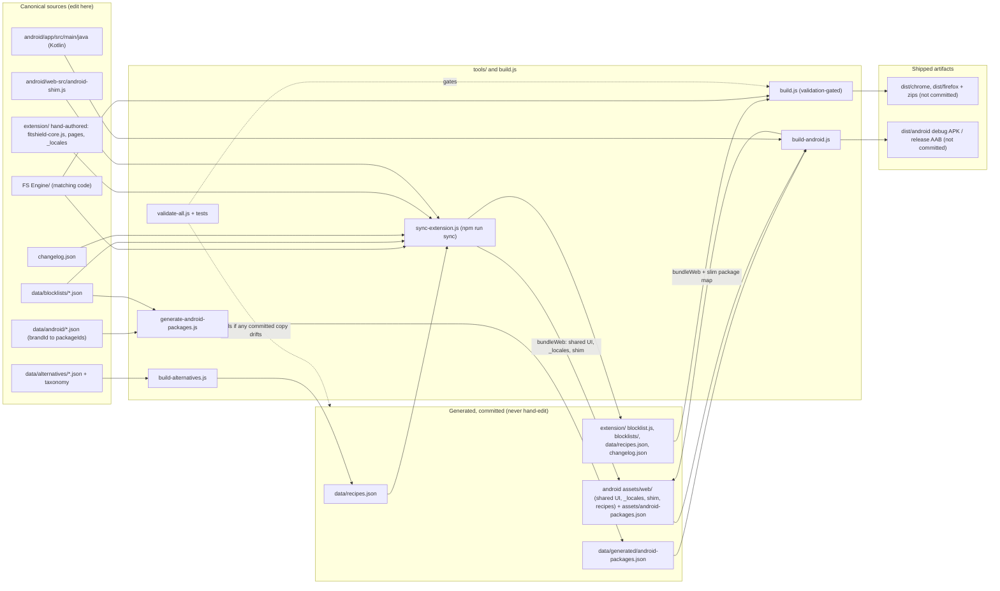
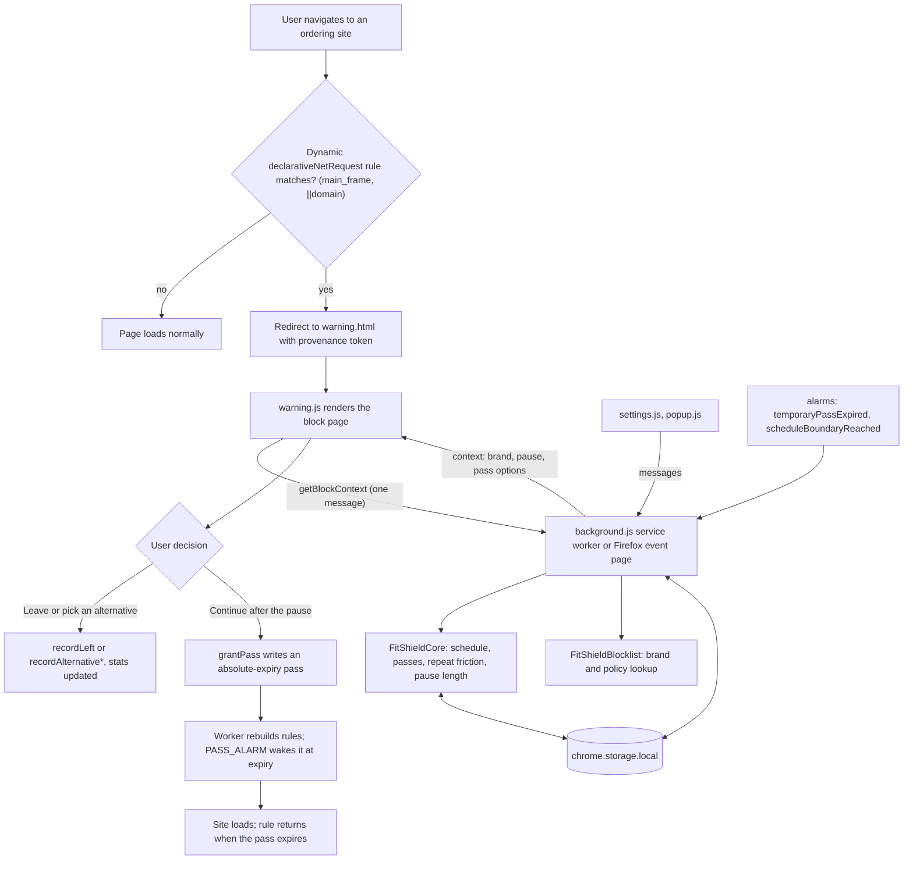
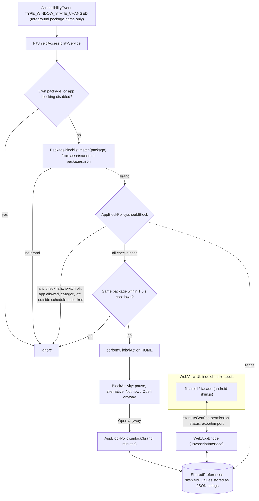
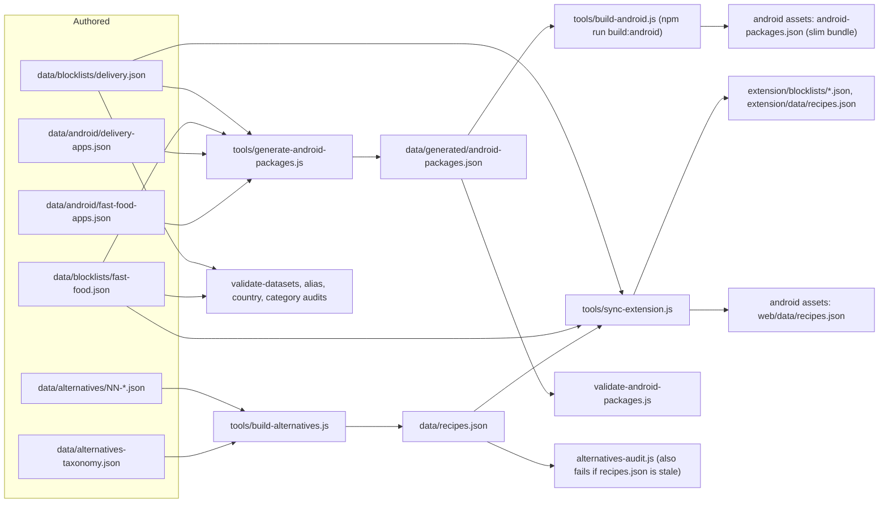

# FitShield architecture

FitShield is a **blocker and a decision-friction tool**, shipped as two products
from one repository:

- a **browser extension** (Chrome, Firefox, Firefox for Android; Manifest V3)
  that interrupts food-delivery and fast-food **websites** with a pause page and
  a home-cooked alternative, and
- an **Android app** that does the same for the food-delivery and fast-food
  **apps** (by package name, through an opt-in accessibility service). It does
  not block websites; VpnService and website blocking were removed in 1.0.

Both are entirely local: no accounts, no network calls, no telemetry. FitShield
1.0 is the final feature release; the project is in maintenance mode.

Where to read next: [docs/EXTENSION.md](docs/EXTENSION.md) (build, manifests,
block-page runbook), [docs/ANDROID.md](docs/ANDROID.md) (the native app),
[docs/STORAGE.md](docs/STORAGE.md) (every stored key and migration),
[docs/LOCALIZATION.md](docs/LOCALIZATION.md) (83 locales),
[FS Engine/README.md](FS%20Engine/README.md) (engine API and dataset contract),
[tools/README.md](tools/README.md) (every validator and generator), and the
folder READMEs: [data/](data/README.md), [android/](android/README.md),
[test/](test/README.md), [brand/](brand/README.md).

## 1. The repository at a glance

Four compartments, plus the tools that recombine them. Keeping them apart is
deliberate: the blocking engine is reusable, and neither product ships a copy of
the other's code.

```
FS Engine/   the blocking engine — CODE ONLY, zero data, zero deps
data/        the canonical datasets — blocklists, alternatives, android app maps
extension/   the Chrome/Firefox extension shell — manifest, pages, shims, _locales, icons
android/     the Android app — Kotlin + a WebView UI sharing the extension's web code
tools/       validators, generators, packagers (developer-only, never shipped)
build.js     recombines FS Engine + data + extension  →  dist/<browser>/ + zips
```



Only the generated copies are ever loaded at runtime. After editing the engine,
`data/`, the shared web modules or locales, run `npm run sync`; after editing
alternatives run `npm run generate:alternatives`; after editing `data/android/*.json`
run `npm run build:android`, which regenerates and re-bundles the package map
(see [data/README.md](data/README.md)).

## 2. Extension runtime



Key points (details in the sections below and in
[docs/EXTENSION.md](docs/EXTENSION.md)):

- **Rules are derived, not stored.** The worker turns blocklist entries plus the
  user's settings into dynamic redirect rules (`updateDynamicRules`). Passes
  and schedule boundaries change the rules; the two alarms re-arm the worker
  because an MV3 worker can be torn down at any moment.
- **The worker is the only holder of decisions.** Pages never read the engine;
  they message the worker, and the worker resolves everything against
  `FitShieldBlocklist` (matching) and `FitShieldCore` (everything around it).
- **State lives in `chrome.storage.local` only**, schema-versioned and migrated
  on wake-up (`ensureMigrated`). See [docs/STORAGE.md](docs/STORAGE.md).
- **Provenance token.** The block page is a web-accessible resource, so the
  worker only honours it when its URL carries the token of a redirect the worker
  itself issued; a site cannot frame or forge it.

## 3. Android runtime



The five `shouldBlock` checks run in this order: `appBlockingEnabled` (default
on), brand not in `appAllowBrands`, category toggle on, `Schedule.withinWindow`,
no live `appUnlocks` entry for the brand.

- The web UI and the Kotlin policy meet **only** through `SharedPreferences`
  (`fitshield`). The shim writes JSON-encoded values; `AppBlockPolicy` strips
  the quoting when it reads them, so a default has to be declared on both sides
  (see [Defaults](#11-defaults-a-switch-that-is-off-is-a-feature-that-does-not-exist)).
- Nothing in the app opens a network connection: no `INTERNET` permission.
- File-by-file notes: [android/README.md](android/README.md); behaviour,
  permissions and device checklist: [docs/ANDROID.md](docs/ANDROID.md).

## 4. Data pipeline



`data/android/` and `data/generated/` never enter a browser package
(`build.js` `ANDROID_ONLY_PREFIXES`); the browser fetches only `blocklists/*.json`
and `data/recipes.json`.

## 5. Invariants and where each is enforced

| Invariant | Enforced by |
| --- | --- |
| **Zero dependencies**, test harnesses included | `test/governance.test.js` ("the project still ships with no dependencies"); the CI "nothing to install" step in `.github/workflows/verify.yml` |
| **Permissions are exactly** `storage`, `declarativeNetRequest`, `alarms` (extension) | `tools/extension-audit.js` (manifest and API-surface grep), `test/package-integrity.test.js` on the packaged bytes, `test/governance.test.js` against `development-policy.json` |
| **Android permissions are a fixed list** (no `INTERNET`, no VPN, no `QUERY_ALL_PACKAGES`) | `tools/android-audit.js`, `test/play-release.test.js`, `test/android-no-vpn.test.js` |
| **Local-first: no network, telemetry, accounts or cloud** | extension `connect-src 'self'` CSP (`tools/extension-audit.js`), `test/security.test.js`, `test/security-verification.test.js`; Android has no `INTERNET` permission |
| **Migrations are idempotent, versioned, never reset data** | `FitShieldCore.migrateState`; `test/core-schema.test.js`, `test/backup.test.js`, `test/resilience.test.js`. See [docs/STORAGE.md](docs/STORAGE.md#migrations) |
| **Generated files match their sources** | `tools/sync-audit.js`, `test/extension-synced.test.js`, `tools/alternatives-audit.js`, `tools/validate-android-packages.js`, `tools/android-audit.js` (Android web bundle drift) |
| **Packages contain only runtime files** | `build.js` `verifyStage`, `test/package-integrity.test.js` |
| **Docs make no claim the code does not honour** | `test/docs-claims.test.js`, `tools/check-doc-links.js`, counts re-derived from data |
| **A finding is work; no terminal verdicts** | `tools/policy-audit.js`, `test/governance.test.js` ([CLAUDE.md](CLAUDE.md), [development-policy.json](development-policy.json)) |

`npm test` runs the whole suite (which includes every audit); `npm run validate`
prints the human-readable audit report. See [test/README.md](test/README.md).

## 6. The two runtime globals

Everything in the extension talks to exactly two shared modules, and never to
each other's internals:

| Global | File | Owns |
| --- | --- | --- |
| `FitShieldBlocklist` | `blocklist.js` (generated from `FS Engine/`) | *Should this host be interrupted?* Hostname normalization, entry matching, country/category policy. |
| `FitShieldCore` | `extension/fitshield-core.js` (hand-authored) | *What should happen around that?* Storage schema and migrations, friction profiles, schedule evaluation, temporary-pass scopes and expiry, repeat-access friction, the statistics vocabulary, and validation of anything the user typed. |

`FitShieldCore` is deliberately pure — no DOM, no `chrome.*`, no network, and no
clock read it was not handed — because the same file runs in four places: the
Chromium service worker (`importScripts`), the Firefox event page
(`background.scripts`), every extension page (`<script src>`), and Node under
`node --test`. That is what makes a schedule, a pass expiry, or a migration
testable without a browser, and what stops the popup and the worker disagreeing
about what "evenings" or "until tomorrow" means.

Load order matters and is enforced: `background.js` references both globals, so
it is imported last in the Firefox `background.scripts` array
(`tools/extension-audit.js`) and importScripts only those two files
(`tools/service-worker-audit.js`).

The same rule applies to the **pages**, and is easier to get wrong there. These
are classic scripts sharing one global scope, so a `<script>` that captures
`FitShieldCore` at load time silently gets `undefined` if its tag sits above
`fitshield-core.js` — no error, just a module that quietly stops validating.
That exact bug shipped in `backup.js` and made restored backups skip clamping
and re-validation.

The enforced rule is ordering: every page lists `fitshield-core.js` before any
consumer, and `test/page-scripts.test.js` evaluates each page's real script chain
in document order, failing on a `ReferenceError` or on a shared constant nothing
in the chain declares. `backup.js` additionally resolves the global **lazily, on
first use**, and throws rather than continuing without it — it is the one path
where a missing validator degraded *silently* instead of failing, which is worse
than a crash. Other consumers bind at load and use `core.*` directly, so a broken
order throws immediately; that is acceptable precisely because the order is
tested.

`FitShieldCore` is shared across the extension's own surfaces — **not** with the
Android app, which does not bundle it and re-implements the subset it needs in
Kotlin. Every resulting behavioral difference is enumerated and classified in
[`docs/ANDROID.md`](docs/ANDROID.md) ("Intentional Android deviations").

## 7. The alternatives catalog

`data/recipes.json` keeps its historical name and `recipes` array (the Android
WebView and older readers still fetch it), but it is now **generated**:

```
data/alternatives-taxonomy.json   vocabularies + blocked-category → craving maps
data/alternatives/*.json          the authored entries, grouped by craving
        ↓  npm run generate:alternatives   (tools/build-alternatives.js)
data/recipes.json                 one file, fetched in one request by the block page
```

Authored in parts because an 88-entry file is unreviewable in a diff; shipped as
one file because the block page must load everything it needs before a countdown
that may only last twenty seconds. `tools/alternatives-audit.js` runs in
`npm run validate` and `npm test`, and separates decidable **errors** (a missing
quantity, a vegan entry containing dairy, heat with no temperature or doneness
cue, an unknown tag) from fuzzy **warnings** (near-duplicate titles, an
ingredient that looks unreferenced) — a natural-language guess can never fail a
build. It also fails if `data/recipes.json` is stale relative to its sources.

Matching lives in `extension/recipes.js` (page-side, `FitShieldRecipes`), not in
`FS Engine/`: the engine stays code-only and blocking-only.

Deep dives: **[FS Engine/README.md](FS%20Engine/README.md)** (engine API + data
contract) and **[docs/EXTENSION.md](docs/EXTENSION.md)** (build, engine linkage,
manifests, and the block-page debugging runbook). This file is the map that ties
them together.

## 8. Source of truth vs. generated output

| Concern | Source of truth (edit here) | Generated (never hand-edit) |
| --- | --- | --- |
| Blocking logic | `FS Engine/*.js` | `extension/blocklist.js` (synced), `dist/*/blocklist.js` |
| Decision layer | `extension/fitshield-core.js` | — (hand-authored, copied verbatim by the build) |
| Blocklists | `data/blocklists/*.json` | `data/generated/*`, `extension/blocklists/`, `dist/*/blocklists/` |
| Alternatives | `data/alternatives-taxonomy.json`, `data/alternatives/*.json` | `data/recipes.json`, `extension/data/`, `dist/*/data/` |
| Changelog | `changelog.json` (root) | `extension/changelog.json` (synced) |
| Extension shell | `extension/` (hand-authored js/html/manifest) | `dist/chrome/`, `dist/firefox/`, `dist/*.zip` |
| Manifests | `extension/manifest.json` (Chromium base) | `dist/chrome/manifest.json`, `dist/firefox/manifest.json` |

`node build.js` compiles **both browser targets** on each run — Chrome and
Firefox. Both are the same payload with a per-browser manifest derivation
(`chromeManifest` / `firefoxManifest` in `build.js`). Android is a separate native
pipeline (`npm run build:android`); `npm run build:all` runs everything.

`dist/` is git-ignored — it is entirely reproducible with `node build.js`.
**The `extension/` folder loads directly as an unpacked extension**: the runtime
artifacts it fetches (`blocklist.js`, `blocklists/`, `data/recipes.json`,
`changelog.json`) are committed there, generated/copied from canonical
`FS Engine/` + `data/` by `npm run sync`. After editing the engine or data, run
`npm run sync` — which also refreshes the Android app's copy of the same shared
web assets, so the two can never drift from one ordinary edit.
`tools/sync-audit.js` (in `npm run validate`) and
`test/extension-synced.test.js` (in `npm test`) fail if a committed copy drifts.
The repo *root* is still not loadable — load `extension/` (fastest) or the built
`dist/chrome/` / `dist/firefox/` (store-shaped).

## 9. How the extension consumes the engine

The engine is authored as CommonJS modules in `FS Engine/` and is **never
hand-copied** into the extension. `build.js` (`bundleEngine`) wraps those modules
into one deterministic classic script — **`blocklist.js`** — whose only public
surface is the `FitShieldBlocklist` global. That same bundle is committed at
`extension/blocklist.js` by `npm run sync` (so the source folder loads unpacked)
and written to the package root by `build.js` (so the store artifact ships it);
both come from the one `bundleEngine`, and `tools/sync-audit.js` proves the
committed copy equals it. `test/engine-bundle.test.js` proves the global is
byte-for-byte the same API as `require("./FS Engine")`.

That global **is the stable adapter boundary.** Nothing in the extension reaches
into engine internals by relative path:

- **`background.js`** (service worker / Firefox event page) loads `blocklist.js`
  and calls the engine's public API (`loadBlocklists`, `getEntryDomains`,
  `shouldBlockByCountry`, …) to turn entries + user settings into
  `declarativeNetRequest` rules.
- **`browser-shim.js`** is the *platform* adapter: it exposes a
  platform-agnostic `fitshield.*` façade over `chrome.*` so the same UI runs on
  the Android WebView (which ships `android-shim.js` instead). The engine
  (`FitShieldBlocklist`) and the platform (`fitshield`) are the two boundaries —
  UI code targets those names, not raw APIs or engine files.
- **UI pages** (`warning.html`, `popup.html`) never touch the engine directly.
  They message the background worker (`runtime.sendMessage`), so every block
  decision, bypass, and stat flows through the single engine-backed worker.

## 10. The block page dependency chain

The block page is the surface most sensitive to the engine split, because it
depends on the engine *transitively* through the worker. The chain:

```
blocked site
  → declarativeNetRequest redirect  (background.js, rules built from the engine)
  → warning.html  (web_accessible_resource; the DNR redirect target)
      loads: ambient.js, browser-shim.js, i18n.js, fitshield-core.js,
             recipes.js, warning.js
      fetches: data/recipes.json  (the alternatives catalog),
               _locales/<lang>/messages.json  (localization)
  → warning.js  messages the worker:
      getBlockContext  ← ONE round trip: brand, pause length (including any
                          repeat-visit addition and why), pass options, and the
                          user's matching preferences
      then, as the user acts:
      recordInterruption · recordBlockedBrand · recordAlternativeShown ·
      recordAlternativeSelected · recordAlternativeDismissed · recordLeft ·
      grantPass
  → background.js resolves each against FitShieldBlocklist + FitShieldCore
```

`getBlockContext` is deliberately one message rather than six: the page has to
render before a countdown that may only be twenty seconds long, and every extra
round trip to an MV3 worker can pay a cold-start cost.

Every recording path takes the same `preview` flag. `warning.html?preview=1`
runs the identical flow and records nothing — no interruption counted, no
rotation history written, no pass granted, no site unblocked. That is what
Settings → Preview and onboarding's "Show me" both open.

Every hop is guarded so a future path/layout change fails loudly instead of
shipping a blank page:

- **`build.js` → `verifyStage`** re-reads the staged package and asserts
  `warning.html`, each asset it loads, `blocklist.js`, `data/recipes.json`, and
  the engine datasets are all present — the build aborts otherwise.
- **`tools/extension-audit.js`** proves the whole package graph is closed and no
  page carries an inline script (MV3 CSP).
- **`test/block-page.test.js`** checks the packaged graph *and* renders the block
  page end-to-end against the real engine-backed worker (brand, block reason,
  recipes, stats, locale, theme).

## 11. Defaults: a switch that is off is a feature that does not exist

Every blocking control ships **on**, and the only thing standing between a fresh
install and working protection is a permission the user must grant. That is a
deliberate rule, and it was broken once in a way worth recording.

`AppBlockPolicy.appBlockingEnabled` defaulted **false** while every `appBlock*`
category under it defaulted **true**. The visible result was that a user could
turn FitShield on, grant the accessibility service, watch sites get blocked, and
still have DoorDash open normally — with nothing on screen explaining why, because
the one switch that mattered was off and had never been shown to them. A default
of `false` on a master switch silently disables everything beneath it, however
correct those things are.

The rule, in both platforms:

- **Preferences default to on.** `deliverySitesEnabled`, `fastFoodSitesEnabled`,
  `customSitesEnabled` (extension, `defaultState()` in `fitshield-core.js`) and
  `appBlockingEnabled` plus every `appBlock*` category (Android,
  `AppBlockPolicy.kt`). Absent from storage must read as **enabled**.
- **Permissions are the only gate.** A default of `true` grants nothing by
  itself: app blocking
  still needs the AccessibilityService, which only the user can turn on and only
  after the in-app disclosure. "Blocks nothing until you turn it on" is enforced
  by the permission, not by a preference being off.
- **A default is stored in two places and they must agree.** The Kotlin reader
  and the web UI that renders the switch each carry their own fallback
  (`AppBlockPolicy.isEnabled` / `shouldBlock`, and `app.js`). When those two
  disagree the switch shows one state and the behaviour is the other, which is
  strictly worse than either being wrong on its own. `test/android-controls.test.js`
  holds the category lists together; the master switch is asserted alongside them.
- **Say what is still missing, on the dashboard.** App blocking needs a
  permission the user grants elsewhere, so the main status card carries the
  prompt for it (`#appBlockSetup`), shown only when app blocking is enabled and
  the accessibility service is not. It routes through the same disclosure gate as
  the settings-panel button — a second entry point that skipped the disclosure
  would be a Play violation, not a shortcut.
- **Permission rows are polled, not latched.** `refreshPermissionStatuses()` runs
  on the same 2s interval as the headline and after the main toggle. It used to
  run only on load and on `visibilitychange`, so granting the accessibility permission left
  the permission row reading "Off" next to a dashboard already reading "On".

Force-stopping the app (Settings → Force stop, or an aggressive task killer)
makes Android drop the AccessibilityService: `enabled_accessibility_services`
becomes `null` and app blocking stops until the user turns it back on. Nothing in
the app can prevent that; the dashboard prompt above is what makes it visible
rather than silent.

## 12. Build & verify

```
node build.js        # validate → stage FS Engine + data + extension → dist/ + zips
npm test             # full suite (includes every audit + the block-page tests)
npm run validate     # human-readable audit report
```

See [docs/EXTENSION.md](docs/EXTENSION.md) for per-browser loading, the manifest
strategy, and what to check first when the block page misbehaves.
