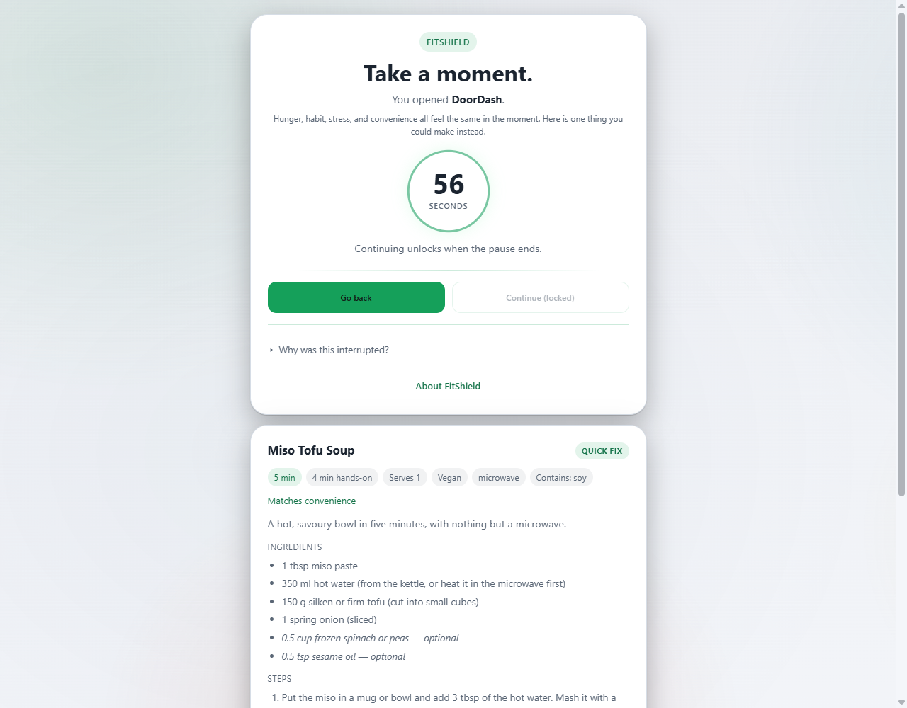
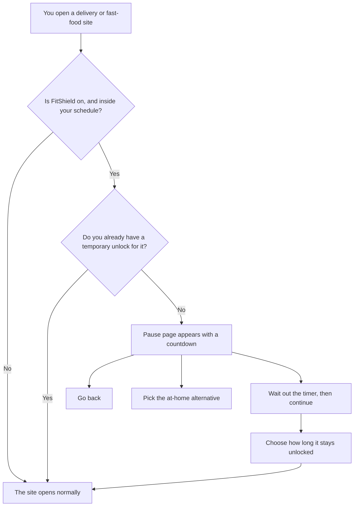
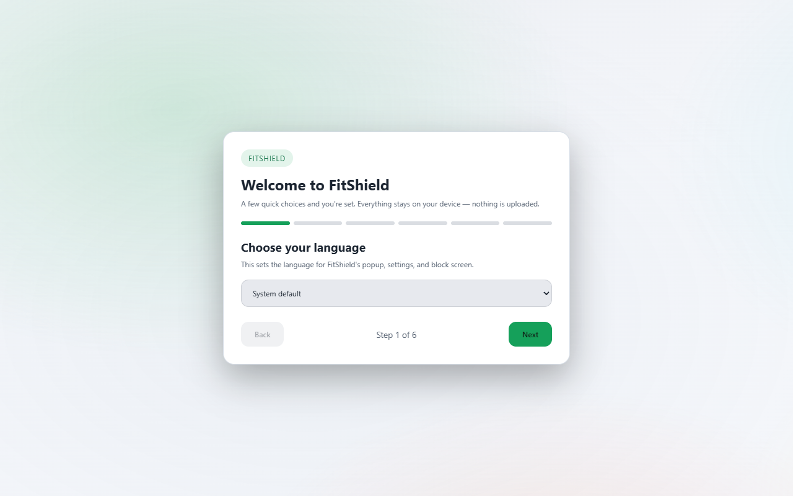
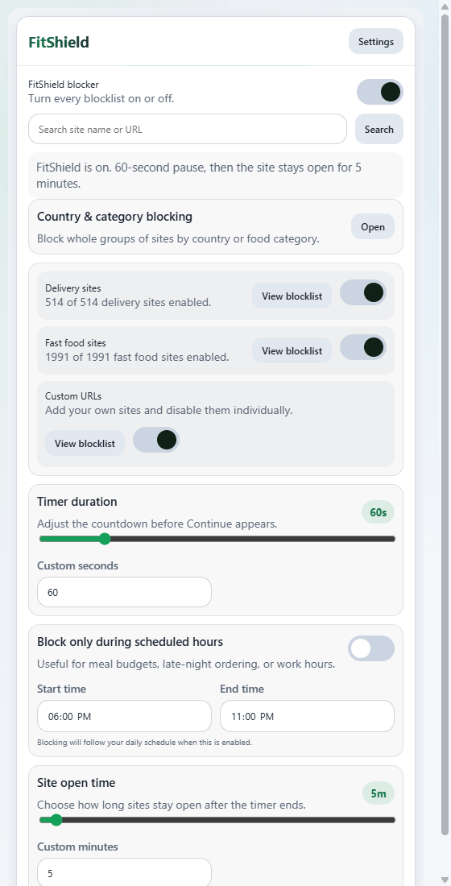
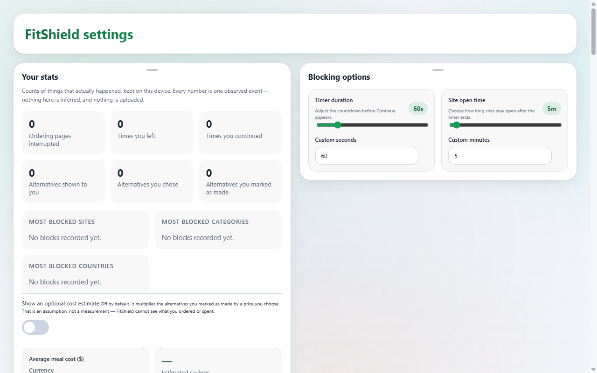
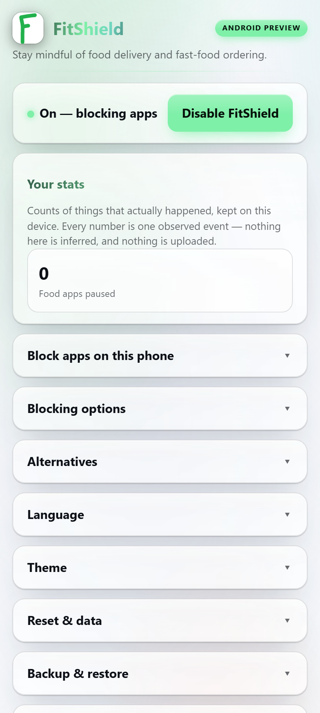

# FitShield for everyday users

FitShield is a speed bump between you and the delivery app. When you open a
food-delivery or fast-food site (or, on Android, app), FitShield stops you for a
few seconds and shows you something you could make at home instead. After that,
**you decide.** It is a nudge, not a lock.

Everything stays on your device. There are no accounts, no tracking, and no
connection to any FitShield server.

## What it does, and what it doesn't

**It does**

- Pause you before you reach thousands of delivery and fast-food sites (2,505 brands in 111 markets).
- Offer an at-home alternative: 88 ideas, from full recipes to five-minute fixes.
- Let you pick how firm it is: pause length, how long a site stays open after you continue, and the hours it is active.
- Keep private, on-device counts of how often it stepped in.

**It doesn't**

- Track you, collect your browsing history, or send anything anywhere.
- Count calories, plan meals or coach you. It is not a fitness app.
- Lock you out. You can always continue after the timer, and you can turn FitShield off.
- Block websites in the Android app, or in Chrome on Android (see [the Android section](#the-android-app)).

## What happens when you open a blocked site

## Install

**Chrome, Brave, Edge and other Chromium browsers**
[Chrome Web Store](https://chromewebstore.google.com/detail/fitshield/oedcadhhfcgggacgljhnochcjdibfjed)

**Firefox, and Firefox for Android**
[addons.mozilla.org](https://addons.mozilla.org/en-US/firefox/addon/fitshield/)
(Firefox 140 or newer; 142 or newer on Android.)

**The Android app** is not on Google Play: approval is still pending. Until it
is, the app has to be built from the source code, which needs a developer's
tools. See [`docs/ANDROID.md`](docs/ANDROID.md). If all you want is website
blocking on your phone, install Firefox for Android and add the extension.

**From a release build instead of a store:** someone with Node.js can run
`node build.js` in the repository. In Chrome open `chrome://extensions`, switch
on Developer mode, choose Load unpacked, and select the `dist/chrome` folder. In
Firefox open `about:debugging#/runtime/this-firefox`, choose Load Temporary
Add-on, and select `dist/firefox/manifest.json`. (Firefox forgets temporary
add-ons when it closes.)

## First run

On first install FitShield opens a welcome page.

1. Click the FitShield icon in your toolbar to open the popup. The big switch turns blocking on or off.
2. Pick how much friction you want (see below). **Standard** is a sensible start.
3. Try it: in Settings, **Preview and test** shows the pause page without visiting a real site.

## The pause page

- **A countdown.** You can continue only after it ends; until then the button is locked.
- **An alternative.** A recipe or quick fix you can make instead. You can ask for another one, mark favorites, or choose one.
- **Three ways out:** go back, choose the alternative, or continue on purpose.
- **A short, skippable question** about what brought you there, if you switch it on. The answer is never saved.
- **Why it paused**, expandable, so there are no mystery delays.

When you continue you choose how long that site stays open: your usual duration,
10 or 30 minutes, until you close the tab, or all food sites for 30 minutes or
until tomorrow.

## Settings explained

Open the popup and choose Settings, or use your browser's extension options.

| Setting | What it does |
| --- | --- |
| **Your stats** | Aggregate counts of pauses and your most-blocked sites, categories and countries. Never URLs. One optional estimate of money saved (off unless you enable it). |
| **Blocking options** | The pause timer (how long the countdown runs) and the post-timer access duration (how long a site stays open after you continue). |
| **How much friction** | Light, Standard or Strict presets for the above. Changing any value moves you to Custom. Optionally "Longer pause on repeat visits": one small, fixed extra delay if you return to a site soon after continuing. |
| **When FitShield is on** | Schedule presets (always, evenings, late night, weekday lunch, evenings and weekends) or your own windows. Times follow your device clock. "Block until tomorrow" overrides the schedule; "Cancel that" undoes it. |
| **Your kitchen** | Diet, allergens, equipment and pantry, used only to rank the alternatives shown to you. |
| **Your own alternatives** | Add your own recipes or fixes to the pause page. |
| **Customize blocklist** | Search every site; switch delivery sites, fast-food sites or custom URLs on or off as groups; add your own sites. |
| **Country and category blocking** | Block whole groups of brands by where they operate or what they serve (21 categories). |
| **Language** | 83 display languages with a search box. |
| **Theme** | System, light or dark, plus your own colors, corner radius and popup width. |
| **Backup and restore** | Export everything to one JSON file; import it elsewhere. |
| **Reset and data** | Reset blocking, appearance or preferences separately, or factory reset. |

There is no domain "always allow" list in the extension. To stop a single site
being blocked, switch it off in Customize blocklist.

## The Android app

The app pauses food-delivery and fast-food **apps** on your phone (1,512 app
packages are bundled). It does not block websites; use Firefox for Android with
the extension for that.

**Why it asks for the Accessibility permission.** Android gives apps no other
way to learn which app just opened. FitShield's accessibility service listens
only for window changes to read one thing: the **name of the app in the
foreground** (for example, a package name). It is configured with
`canRetrieveWindowContent=false`, so it cannot read what is on your screen,
your messages or your passwords. The app shows a disclosure and asks for your
consent before it will open Accessibility settings, and you can switch the
service off at any time in Android settings. The app has no internet permission
at all.

**What you can set**

- **Enable FitShield**, the main switch for app blocking.
- **Block which apps:** categories (delivery, fast food, restaurant, coffee, dessert, grocery, meal kit), plus a list to turn individual apps off.
- **Temporary unlock (minutes):** how long "Open anyway" unlocks that app.
- **Pause timer and schedule:** under Blocking Options.
- **Optional keep-alive:** "Extra reliability" runs a quiet always-on notification so your phone doesn't stop app blocking after long idle. Turn it on only if blocking stops working after FitShield has been closed for a while. You may also be asked to allow display over other apps (so the pause screen reliably appears) and unrestricted battery use.
- **Language, theme, export and import**, as in the extension.

## Privacy in plain words

- FitShield never sends your data anywhere. The extension makes no network calls of its own and the Android app cannot connect to the internet.
- No account, no analytics, no ads.
- Stats are counts stored on your device. They are not tied to URLs or history.
- Your settings are yours: export them to a file, or wipe them with a reset.
- The extension asks only for the browser permissions `storage`, `declarativeNetRequest` and `alarms`.

## FAQ and troubleshooting

**A site I expected isn't blocked.** Open Settings, then Customize blocklist, and search for it. If it is listed, check that its group is on, FitShield is switched on in the popup, and your schedule covers the current time. If it isn't listed, add it as a custom URL, and consider reporting it (below).

**Chrome on Android isn't covered.** Chrome for Android cannot run extensions, and the FitShield Android app no longer blocks websites. Use Firefox for Android with the FitShield extension.

**The Android app didn't pause an app.** Check that Enable FitShield is on, the Accessibility service is on, the app's category (or the app itself) is selected, and you're inside your schedule. The app may be in your temporary-unlock window. If blocking stops after idle, enable the keep-alive option. Force-stopping the app makes Android switch off its accessibility service; turn it back on in Android settings.

**How do I turn it off temporarily?** Flip the switch in the popup (extension) or Enable FitShield (Android). To avoid fiddling, set a schedule so FitShield is only on when you want it. For one site, choose Continue and pick a duration.

**Can I skip the countdown?** No. The timer is the point. You can shorten it in Settings (Light friction), but you can't remove it.

**How do I export my settings?** Settings, Backup and restore, Export. Import the file on another browser or after a reinstall. On Android the same buttons are at the bottom of the app.

**Will a reset delete my stats?** Reset statistics clears them; Reset settings and Reset appearance keep them. Factory reset clears everything.

## Reporting a problem

In Settings, scroll to **Report a problem**. Choose what is wrong, name the
site or alternative, and add any detail. The form shows you exactly what the
report would say and offers a **Copy this report** button. Nothing is sent on
its own: paste the copied text into an issue at
[github.com/EeshGarg/FitShield/issues](https://github.com/EeshGarg/FitShield/issues).
Only the domain is included, never your history, settings or stats.
Settings also has a diagnostics page (look for the diagnostics link beside
Preview and test) if you're asked for more detail.
