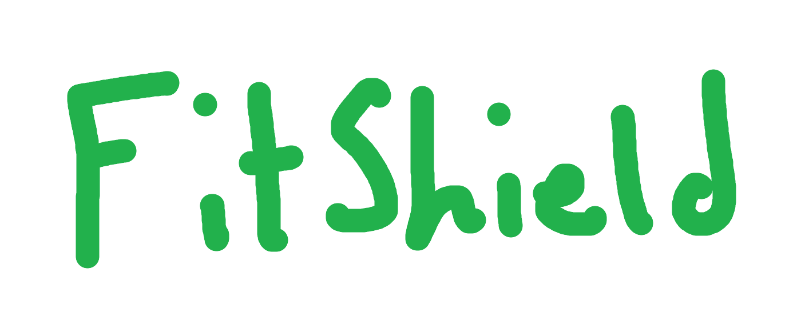
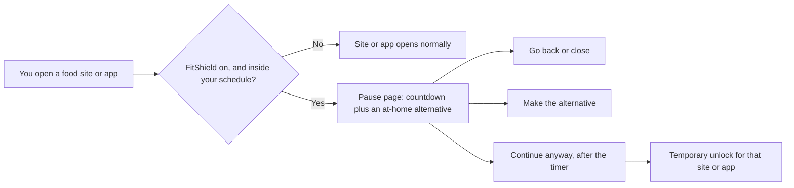

<p align="center">
  
</p>

# FitShield

**A speed bump between you and the delivery app.** FitShield interrupts
food-delivery and fast-food ordering with a short pause and an at-home
alternative — a recipe or a quick fix — so ordering becomes a decision instead
of a reflex. It is a browser extension (Chrome and other Chromium browsers,
Firefox, Firefox for Android) plus an Android app that pauses food-delivery
*apps*. Everything runs on your device: no accounts, no telemetry, no network
calls, no browsing-history collection.

> Status: **FitShield 1.0 is the final feature release.** The project is in
> maintenance mode — fixes and policy compliance only.

## How it works



## Where it works

| Platform | What FitShield blocks | How |
| --- | --- | --- |
| Chrome / Brave / Edge (desktop) | Websites | Browser extension (`declarativeNetRequest`) |
| Firefox (desktop, 140+) | Websites | Browser extension (event-page build) |
| Firefox for Android (142+) | Websites | The same extension |
| Chrome for Android | Nothing | Chrome on Android cannot run extensions |
| FitShield Android app | Food-delivery and fast-food **apps** | Opt-in AccessibilityService reading only the foreground package name |

The Android app does **not** block websites: its VpnService was removed for
Google Play compliance (see [`changelog/1.0.md`](changelog/1.0.md)). Use Firefox
for Android with the extension for sites on a phone.

## What you get

- **2,505 curated brands across 111 markets** — delivery platforms and fast-food chains — plus custom URLs.
- Country and category blocking: **21 curated categories**.
- Adjustable pause timer, post-timer access duration, and scheduled hours.
- At-home alternatives on the pause page — **88 alternatives**, **46 full recipes** and **42 quick fixes**.
- Private, on-device stats and a downloadable JSON export/import of all your data.
- **83 display languages** with a searchable picker; system / light / dark themes and full color customization.

## Choose your path

| You are... | Start here |
| --- | --- |
| Someone who just wants to use FitShield | [`CONSUMERS.md`](CONSUMERS.md) |
| A contributor (brands, recipes, locales, code) | [`docs/GETTING_STARTED.md`](docs/GETTING_STARTED.md) |
| A maintainer or releaser | [`docs/MAINTAINING.md`](docs/MAINTAINING.md) |
| An AI agent working in this repo | [`CLAUDE.md`](CLAUDE.md) and [`.claude/agents/`](.claude/agents/) |
| Reporting a bug or a security issue | [`SUPPORT.md`](SUPPORT.md) and [`SECURITY.md`](SECURITY.md) |
| Looking for any other document | [`docs/README.md`](docs/README.md) |

## Install

- **Chrome / Brave / Edge:** [Chrome Web Store](https://chromewebstore.google.com/detail/fitshield/oedcadhhfcgggacgljhnochcjdibfjed)
- **Firefox and Firefox for Android:** [addons.mozilla.org](https://addons.mozilla.org/en-US/firefox/addon/fitshield/)
- **Android app:** Google Play approval is still pending, so the app is not on Google Play. Build the APK yourself (below) — details in [`docs/ANDROID.md`](docs/ANDROID.md).
- **From source:** run `node build.js`, then load `dist/chrome/` (Chrome: `chrome://extensions`, Developer mode, Load unpacked) or `dist/firefox/manifest.json` (Firefox: `about:debugging#/runtime/this-firefox`, Load Temporary Add-on). You can also load `extension/` directly in Chromium. The repository root is not a loadable extension. Firefox needs 140+ (142+ on Android).

## Quick start for developers

Requires Node.js 22 or newer (CI runs 22 and 24) and zero npm dependencies.

```sh
npm test                  # unit and policy tests
npm run validate          # every dataset, locale, doc and asset validator
npm run build             # dist/chrome/ and dist/firefox/ plus zips
npm run sync              # refresh committed copies after editing FS Engine/ or data/
npm run build:android     # debug APK into dist/android/ (npm run toolchain:android provisions the SDK)
npm run build:all         # extension and Android
```

## Repository map

| Path | What lives there |
| --- | --- |
| `extension/` | Browser-extension source: pause page, popup, settings, background worker, locales |
| `FS Engine/` | Shared blocking engine, reused by the extension and the Android app |
| `data/` | Curated datasets: blocklists, categories, countries, alternatives (licensed separately) |
| `android/` | Native Android app (Kotlin plus a WebView UI) |
| `tools/` | Validators, generators and build helpers (no dependencies) |
| `test/` | Test suite, run with `node --test` |
| `changelog/` | Per-release notes and the roadmap |
| `docs/` | Detailed documentation; archived one-off reports live in `docs/history/` |
| `brand/` | All brand images, including store assets in `brand/store/` |
| `.claude/agents/` | Specialist-agent definitions used for assisted development |
| `build.js` | Packages both browser targets into `dist/` |

Deeper maps: [`ARCHITECTURE.md`](ARCHITECTURE.md), [`CONTRIBUTING.md`](CONTRIBUTING.md),
[`docs/EXTENSION.md`](docs/EXTENSION.md), [`docs/ANDROID.md`](docs/ANDROID.md).

Need help or found a bug? See [`SUPPORT.md`](SUPPORT.md). Security vulnerabilities: [`SECURITY.md`](SECURITY.md) (report privately, never as a public issue).

## Privacy

Local-first is the product. FitShield has no telemetry, no accounts, no cloud
and no network calls of its own. The extension's permissions are exactly
`storage`, `declarativeNetRequest` and `alarms`. The Android app requests no
`INTERNET` permission, so it cannot open a network connection at all; its
AccessibilityService sees only which app came to the foreground and cannot read
screen content. Stats are aggregate counts only — no URLs, no history. The
"Report a problem" form only builds text for you to copy; nothing is sent.

## Contributing and support

Contributions, thoughts and critiques are welcome — read
[`CONTRIBUTING.md`](CONTRIBUTING.md) first, and be kind. FitShield is free and
open source; if it saved you an order, you can optionally
[buy the developer a coffee](https://buymeacoffee.com/eeshgarg).

## Licenses

- Source code: [`LICENSE`](LICENSE)
- Curated data (blocklists, aliases, categories, alternatives): [`DATA_LICENSE.md`](DATA_LICENSE.md)
- Branding: [`BRANDING_LICENSE.md`](BRANDING_LICENSE.md)

The FitShield name, logos, FitJack mascot, trademarks, service marks, trade
dress and all branding assets remain the exclusive property of Usha Corporation
/ Eesh Garg and are not included under either the software or data licenses.
