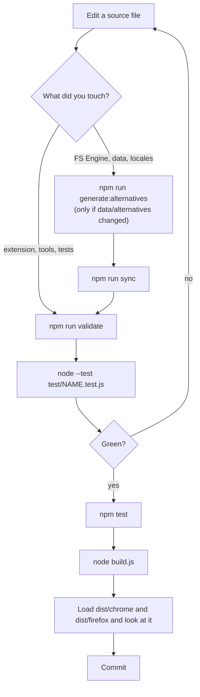

# Getting started

Zero to a first verified change. Allow roughly half an hour; most of it is
waiting for `npm test` and the real-browser audits (add time for the one-off
Android toolchain download if you build the APK).

FitShield has **no dependencies**: no `npm install`, no bundler, no framework.
Everything below uses Node built-ins and the scripts in `package.json`.

## 1. Prerequisites

| You need | For | Notes |
| --- | --- | --- |
| **Node.js 22 or newer** | everything | 22 is the floor (the browser audits speak CDP over Node's global `WebSocket`, available without a flag only from 22). CI runs 22 and 24. |
| **git** | everything | |
| **Google Chrome or Chromium** | `validate:a11y`, `capture`, loading the extension | Point `FS_CHROME` at the binary if it is not found automatically. |
| **Firefox** | `validate:firefox`, loading the extension | Point `FS_FIREFOX` at the binary if needed. |
| **JDK 17 + Android SDK** | building the APK/AAB only | Not needed for anything else. See [section 6](#6-build-the-android-app). |

The browser-driven audits **warn and skip** when no browser is installed, and
`npm run validate` says so ("did not run: ...") rather than reporting a clean
pass. CI treats a skip as a failure; locally you may skip them, but a change to
a user-facing surface should be checked in both browsers before you call it done.

## 2. Clone and prove the baseline

```bash
git clone <repository-url> FitShield
cd FitShield
npm test            # node --test: unit tests, scenario tests, and the validators
npm run validate    # every audit, run directly
```

Both should finish with zero failures and zero errors before you change
anything. If they do not, you have found something worth reporting. See
[`../CONTRIBUTING.md`](../CONTRIBUTING.md).

`npm test` takes a few minutes: it includes real-browser and packaging tests.
To run one file while you iterate:

```bash
node --test test/matching.test.js
```

## 3. Build the extension

```bash
node build.js       # same as: npm run build
```

`build.js` validates first and **aborts on any error**, so a broken tree never
produces a zip. On success it writes:

| Output | Use |
| --- | --- |
| `dist/chrome/` | unpacked Chrome/Chromium package (Load unpacked) |
| `dist/firefox/` | unpacked Firefox package (Load Temporary Add-on) |
| `dist/FitShield-<version>-chrome.zip` | Chrome Web Store upload |
| `dist/FitShield-<version>-firefox.zip` | Firefox / AMO upload |

`dist/` is gitignored. Do not zip by hand: the built-in writer forces
forward-slash archive paths, which Windows' `Compress-Archive` breaks.

## 4. Load it in a browser

The repository root is **not** a loadable extension. Load a built package, or
the `extension/` folder directly (Chromium only), which carries committed copies
of the generated runtime files.

**Chrome / Edge / Brave**

1. Open `chrome://extensions` and switch on *Developer mode*.
2. *Load unpacked* and choose `dist/chrome` (or `extension/`).
3. Visit a blocked site, for example `doordash.com`, to see the block page.

**Firefox**

1. Open `about:debugging#/runtime/this-firefox`.
2. *Load Temporary Add-on* and choose `dist/firefox/manifest.json`.
3. Temporary add-ons are removed when Firefox closes; reload after rebuilding.

After editing the engine, data or locales, run `npm run sync` so `extension/`
picks up the change (`npm test` and `npm run validate` fail on a stale copy).

## 5. The dev loop



Generated files (`data/recipes.json`, `data/generated/*`, the engine bundle and
copies inside `extension/`) are validated against their sources. If you edit a
source and forget to regenerate, the build fails instead of shipping the drift.

## 6. Build the Android app

The Android app is a native shell (WebView UI plus Kotlin) that reuses the
extension's UI code, catalog and locales. It blocks food-delivery and fast-food
**apps** through an opt-in `AccessibilityService`; it does not block websites.
See [`ANDROID.md`](ANDROID.md).

One-time toolchain setup (downloads a JDK 17 and the Android SDK into
`~/.fitshield-toolchain`, outside the repository; nothing system-wide changes):

```bash
npm run toolchain:android
```

If you already have JDK 17 and an Android SDK (`JAVA_HOME` / `ANDROID_HOME`),
you can skip that. Note that `~/.fitshield-toolchain` is preferred when it exists.

**Debug APK** (no signing needed):

```bash
npm run build:android
# -> dist/android/FitShield-<version>-debug.apk
```

Without a toolchain this refreshes and audits the inputs, writes
`dist/android/BUILD.txt`, and exits 0 without an APK. It does not pretend to
have built one, so check that the `.apk` exists.

**Release bundle (AAB)** needs a version code that has never been uploaded to
Play, and signing configuration:

```bash
npm run bundle:android -- --versionCode=<integer>
# -> dist/android/FitShield-<version>-<versionCode>.aab
```

Signing is supplied locally and never committed. Either create a gitignored
`android/keystore.properties` containing `storeFile`, `storePassword`,
`keyAlias` and `keyPassword`, or set the `FITSHIELD_STORE_FILE`,
`FITSHIELD_STORE_PASSWORD`, `FITSHIELD_KEY_ALIAS` and `FITSHIELD_KEY_PASSWORD`
environment variables. An unsigned bundle is reported as a failure. The full
release procedure is in
[`PLAY_STORE_RELEASE_CHECKLIST.md`](PLAY_STORE_RELEASE_CHECKLIST.md).

## 7. Your first change: add a brand

A brand is one entry in a curated dataset. This walks the whole loop on real
files.

This is a rehearsal. Use a real brand if you have a verified correction.
Otherwise use the placeholder below, do not commit it, and discard your own
experiment when you finish.

1. **Edit the source.** Add an object to `entries` in
   `data/blocklists/fast-food.json` (or `delivery.json`). The fields are
   documented in each file's `_schema`, and the recipe is in
   [`../CONTRIBUTING.md`](../CONTRIBUTING.md#add-a-brand):

   ```json
   {
     "domain": "example.com",
     "name": "Example",
     "type": "fast_food",
     "countries": ["US"],
     "regions": ["NA"],
     "category": "burger",
     "specialties": ["burgers"],
     "enabled": true
   }
   ```

   Use only a domain, name and market you can verify. `aliases` is an optional
   field (CONTRIBUTING's sample shows it); this sample omits it.
2. **Validate the data.**

   ```bash
   npm run validate:datasets
   npm run validate:aliases
   npm run validate:countries
   npm run validate:categories
   ```
3. **Android mapping.** Run `npm run port:android-apps` (adds your brand to
   `data/android/*-apps.json` as `needs_review`, preserving existing human
   verdicts), then `npm run generate:android-packages` (rewrites
   `data/generated/android-packages.json`), then
   `npm run validate:android-packages`. A brand with no confirmed package stays
   `needs_review`; never guess a package id. Commit the changed
   `data/android/*.json` and `data/generated/android-packages.json` with your
   data change.
4. **Sync.** `npm run sync` refreshes the committed copies in `extension/` and
   the Android web assets.
5. **Test and look.** `npm test`, then `node build.js`, load `dist/chrome`, and
   visit the new domain: you should land on the block page.
6. **Commit** with a `data:` or `fix(catalog):` style message (see
   [`../CONTRIBUTING.md`](../CONTRIBUTING.md#commits-and-pull-requests)).

Brand and data changes are only accepted in maintenance mode when they are
corrections; see the scope section of CONTRIBUTING.

## 8. Common pitfalls

- **`FS Engine/` has a space in its name.** Quote it in shells
  (`cd "FS Engine"`) and in Markdown links write `FS%20Engine`. In Node,
  `require("./FS Engine")` works as written.
- **Editing generated files.** `data/recipes.json`,
  `data/generated/android-packages.json`, `extension/blocklist.js` and the
  `extension/` copies of data are output. Edit the sources, then regenerate.
- **A stale `extension/` copy.** Symptom: `validate:sync` or a sync test fails.
  Fix: `npm run sync`.
- **Loading the repository root** as an extension. Load `dist/chrome`,
  `dist/firefox`, or `extension/`.
- **Line endings.** Git on Windows may convert LF to CRLF on checkout. The
  sync check ignores CRLF vs LF and the tests tolerate CRLF, so `autocrlf`
  should not matter. If a test fails on a file you did not touch, re-run it on
  a clean checkout before assuming it is a line-ending problem.
- **Browser tests flake under load.** The real-browser audits and the Firefox
  gate start real browsers; running them alongside heavy work (another
  `npm test`, a Gradle build) can time them out. Re-run the single audit
  (`npm run validate:a11y`, `npm run validate:firefox`) on an idle machine
  before assuming you broke something, and do not loosen a timeout to get green.
- **Browser not found.** Set `FS_CHROME` or `FS_FIREFOX` to the executable.
- **Android build "succeeds" with no APK.** With no toolchain it exits 0 by
  design; look for the file in `dist/android/`.
- **Never add a dependency, a permission, a network call or telemetry.** Tests
  enforce all four. See [`../CLAUDE.md`](../CLAUDE.md).

## Where next

- [`GLOSSARY.md`](GLOSSARY.md) for the project's vocabulary.
- [`../ARCHITECTURE.md`](../ARCHITECTURE.md) for how the parts fit.
- [`../tools/README.md`](../tools/README.md) for every validator and generator.
- [`README.md`](README.md) for the full documentation index.
