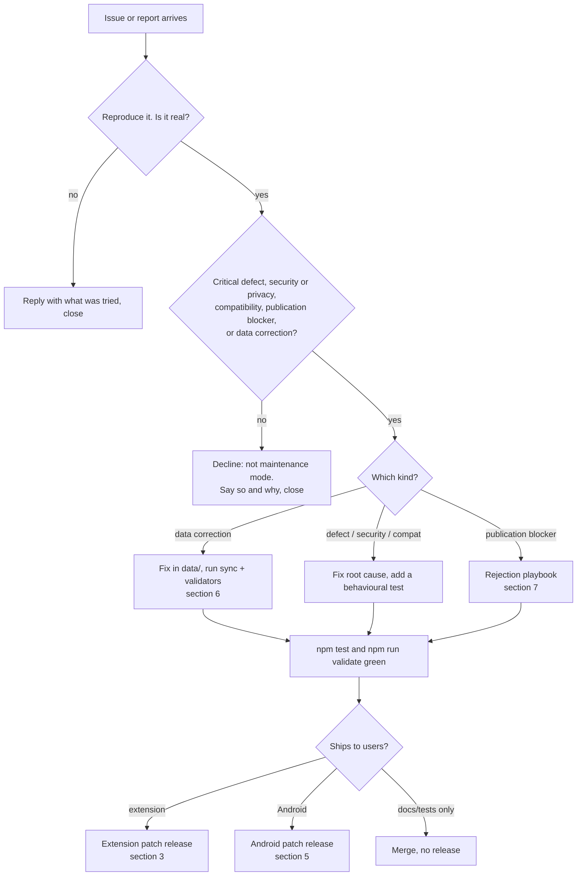
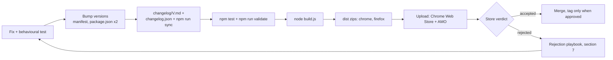
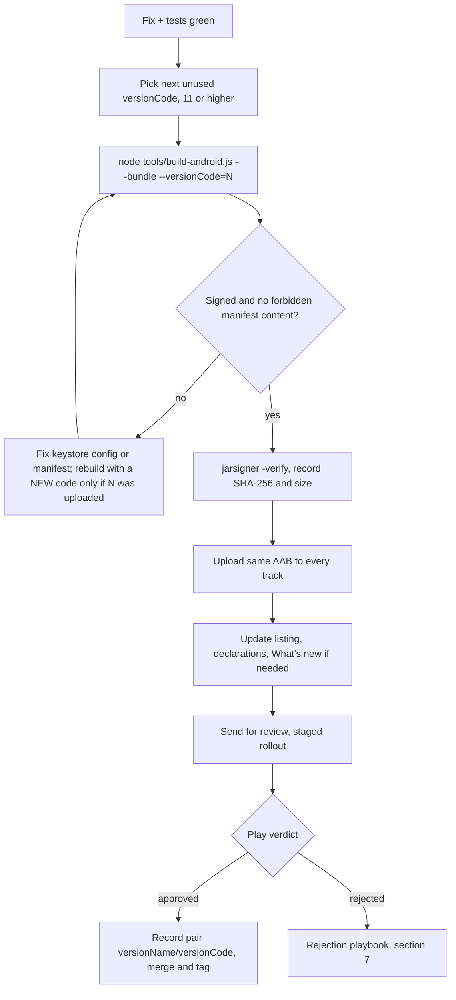
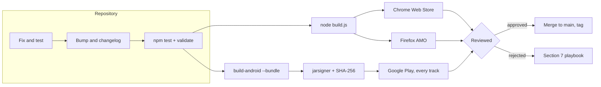

# Maintaining FitShield

_At a glance: the runbook for keeping FitShield alive after 1.0. What counts as
maintenance, how to triage a report, how to cut an extension or Android patch
release, what to do when a store rejects something, and what to check
periodically. Accurate as of 1.0 (2026-11-25). Where this file and
[`CLAUDE.md`](../CLAUDE.md) disagree, `CLAUDE.md` wins._

FitShield 1.0 is the final feature release. The project is in **maintenance
mode**. The Google Play review of 1.0 is **pending**; nothing here assumes it was
approved. Until it is, the release branch `release/1.0-wip` must not be merged to
`main` or tagged (see [PLAY_1.0_RESUBMISSION.md](PLAY_1.0_RESUBMISSION.md)).

Related: [PLAY_STORE_RELEASE_CHECKLIST.md](PLAY_STORE_RELEASE_CHECKLIST.md) (Play
Console steps and evidence), [ANDROID.md](ANDROID.md) (how the app works),
[`changelog/README.md`](../changelog/README.md) (release-note format),
[`tools/README.md`](../tools/README.md) (what each validator checks).

---

## 1. What counts as maintenance work

Only these get work:

| Class | Examples |
| --- | --- |
| **Critical defect** | Blocking silently stops working; a data-loss path; a block page that cannot be dismissed; a crash on launch |
| **Security or privacy issue** | Anything that would add a permission, a network call, telemetry, or leak stored data |
| **Compatibility** | A Chrome/Firefox/Android change that breaks an existing behaviour; a store-mandated target SDK or manifest change |
| **Publication blocker** | A store rejection or policy notice that stops the extension or app being listed or updated |
| **Data correction** | A wrong brand domain, a delisted app package, wrong-country metadata, a translation error |

Not maintenance, so declined: new features, new platforms, new categories of
blocking, redesigns, and anything that would make FitShield a fitness, calorie or
meal-planning product (`CLAUDE.md` section 6). Permissions stay exactly
`storage`, `declarativeNetRequest`, `alarms` (extension) and the Android set in
[ANDROID.md](ANDROID.md). Dependencies stay at zero.



A finding that is safely fixable here is fixed, tested and closed in the same
session; it is never parked as "deferred" (`CLAUDE.md` sections 1 to 3).

---

## 2. Before you touch anything

```bash
node --version      # 22 is the floor; CI runs 22 and 24
npm test            # node --test, zero dependencies, nothing to install
npm run validate    # every audit in tools/validate-all.js
```

There is no `npm install` step and there must never be one. CI
(`.github/workflows/verify.yml`) runs three jobs: `gate` (tests, validators,
Chrome and Firefox packages, on Node 22 and 24), `real-browsers` (accessibility
tree in Chromium, built package installed in real Firefox) and `android` (debug
APK). It never signs, publishes or holds secrets.

Two audits drive real browsers and only do so against a **built** package, so
run `node build.js` before `npm run validate` on a fresh checkout. Set
`FS_CHROME` / `FS_FIREFOX` if browser discovery fails. Locally a missing browser
makes those audits warn and pass; CI uses guards (`.github/ci/run-validate.js`,
`run-a11y.js`, `run-firefox.js`) that fail on a skip. For a release, make sure
they really ran.

---

## 3. Extension patch release (Chrome and Firefox)

### 3.1 Everything that carries the version

| File | Field | Rule |
| --- | --- | --- |
| `extension/manifest.json` | `"version"` (currently `"1.0"`) | The canonical version. Both browser manifests and the Android `versionName` derive from it |
| `package.json` | `"version"` (currently `"1.0.0"`) | Must start with the manifest version (`tools/changelog-validator.js` fails otherwise) |
| `FS Engine/package.json` | `"version"` (currently `"1.0.0"`) | Keep equal to `package.json`. Not enforced by a validator, so check by hand |
| `changelog.json` (repo root) | newest `entries[]` item | Must contain an entry whose `version` equals the manifest version |
| `extension/changelog.json` | copy of the root file | Generated: run `npm run sync`. `tools/sync-audit.js` fails on drift |
| `changelog/<version>.md` | one file per release | Required by `tools/changelog-validator.js` |
| `changelog/README.md` | releases table | Add a row |
| `changelog/ROADMAP.md` | "Current version" and "Completed milestones" | Validator only warns if it does not mention the version; update it anyway |
| `tools/capture-surfaces.js` | stub `getVersion: () => "1.0"` | Screenshot harness fixture; update so captures show the right version |

A patch release is a version like `1.0.1`. The manifest uses a short form
(`1.0.1` is valid for Chrome and Firefox), so set the manifest to `1.0.1` and
`package.json` / `FS Engine/package.json` to `1.0.1`; the prefix rule is then
trivially satisfied. Chrome Web Store requires each upload to have a strictly
greater version than the last published one. A version that was ever uploaded is
never reused.

`android/app/build.gradle` has a fallback `fitshieldVersionName` (`'0.52'`) that
is always overridden by `tools/build-android.js`; do not treat it as a version
carrier.

### 3.2 Steps

1. Branch from the correct base (`main`, or `release/1.0-wip` while Play approval
   is pending and the fix must land on the same line as 1.0).
2. Fix the defect with a test that asserts behaviour, not source text.
3. Bump the versions in the table above.
4. Write `changelog/<version>.md` following the section layout in
   [`changelog/README.md`](../changelog/README.md); only list what shipped. Add the
   short entry to `changelog.json` (it feeds the in-extension What's New) and run
   `npm run sync` to refresh `extension/changelog.json`.
5. `npm test` then `npm run validate` (zero failures, zero errors; never loosen a
   validator to pass).
6. `node build.js`. It stages `dist/chrome` and `dist/firefox`, validates, and only
   then writes the archives. It removes superseded zips, so `dist/` contains
   exactly:
   - `dist/FitShield-<version>-chrome.zip` for the Chrome Web Store
   - `dist/FitShield-<version>-firefox.zip` for Firefox Add-ons (AMO)
7. Confirm both archives: the Chrome package has no `browser_specific_settings`
   and no `background.scripts`; the Firefox one has both plus its gecko id; each
   requests exactly `storage`, `declarativeNetRequest`, `alarms`; no `tools/`,
   `test/`, `changelog/`, `docs/`, `android/`, `.git` or `FS Engine/`.
   `test/package-integrity.test.js` asserts all of this on the archive bytes, so a
   green `npm test` covers it.
8. Upload by hand (the repository does not publish): the Chrome zip in the Chrome
   Web Store developer dashboard, the Firefox zip in the AMO developer hub (AMO may
   ask for source; the repository is the source and the build is `node build.js`).
   If the store asks about permissions or data use, the answers are unchanged:
   no data collected, no remote code, no network access of its own.
9. Record the outcome (submitted / in review / published) in the changelog entry
   or a commit message. Do not write "approved" until the store says so.



---

## 4. Browsers and compatibility checks

Re-verify, do not assume, whenever Chrome or Firefox ships a major change to
Manifest V3, `declarativeNetRequest`, service-worker lifetime, or add-on policy:

- `npm run validate:a11y` (computed accessibility tree in a real Chromium) and
  `npm run validate:firefox` (built package installed in a real Firefox blocking a
  real brand);
- the service-worker audit (`npm run validate:sw`) and extension audit
  (`npm run validate:extension`);
- that dynamic and static rule counts stay inside the browser's current limits.

---

## 5. Android patch release

Identifiers: `applicationId` `com.FitShield.UshaCorporation`; 1.0 is
`versionName 1.0` / `versionCode 10`. `versionName` comes from the extension
manifest automatically. **`versionCode` is never defaulted.** Codes 8, 9 and 10
are spent: 8 was the rejected 0.56 build, 9 was a superseded 1.0 build, 10 is
1.0. **The next free code is 11**, then 12, and so on. Play never lets a code be
reused or reclaimed.

### 5.1 Toolchain

Needs JDK 17 and the Android SDK (platform 36, build-tools 36). If the machine
has neither:

```bash
npm run toolchain:android     # one-off ~400 MB download into ~/.fitshield-toolchain
```

That directory is outside the repository and is not a project dependency.
`tools/build-android.js` prefers it over `JAVA_HOME` / `ANDROID_HOME`. The release
bundle must be signed with the upload keystore; supply it through the gitignored
`android/keystore.properties` (keys `storeFile`, `storePassword`, `keyAlias`,
`keyPassword`) or the `-P` / environment equivalents listed in
[PLAY_STORE_RELEASE_CHECKLIST.md](PLAY_STORE_RELEASE_CHECKLIST.md) section 3.
Never commit a keystore or password, never paste either into a document, and
keep the keystore backed up outside the repository.

### 5.2 Steps

1. Fix the defect; `npm test` and `npm run validate` (includes
   `validate:android` and `validate:android-packages`).
2. Decide the new versionCode (the next unused integer; check the Play Console
   App bundle explorer, which is the authority on what has been uploaded).
3. Build the signed bundle:
   ```bash
   node tools/build-android.js --bundle --versionCode=11
   # -> dist/android/FitShield-<versionName>-11.aab   (and dist/android/BUILD.txt)
   ```
   The script exits non-zero if the bundle is unsigned, if Gradle fails, or if the
   bundle's manifest contains anything on the forbidden list (a `VpnService`, the
   `BIND_VPN_SERVICE` permission, `INTERNET`, `RECEIVE_BOOT_COMPLETED`). If no
   Android tooling is present it skips and exits 0: always confirm the `.aab`
   exists.
4. Verify the signature and record the checksum:
   ```bash
   jarsigner -verify dist/android/FitShield-<versionName>-11.aab
   # expect "jar verified."
   sha256sum dist/android/FitShield-<versionName>-11.aab      # Windows: certutil -hashfile <file> SHA256
   ```
   A rebuild produces a different checksum, so record the SHA-256 of the exact
   file you upload, with the byte size, in the Play doc for that release (see the
   artifact table in [PLAY_1.0_RESUBMISSION.md](PLAY_1.0_RESUBMISSION.md)).
5. Upload the same `.aab` to **every active track** (Production, open, closed and
   internal testing). A track left on an older bundle is still live.
6. Update the "What's new" text, and the Data safety and declaration forms if
   anything they describe changed (it should not; the app has no `INTERNET`).
7. Send the changes for review, then follow the staged rollout in the checklist
   section 10. Write the `changelog/<version>.md` entry, noting the
   `versionName <-> versionCode` pair.



Because a patch to the Android app can change what Play reviews (the
AccessibilityService and foreground-service declarations are the sensitive ones),
re-read the declaration text in [PRIVACY_POLICY_ANDROID_NOTES.md](PRIVACY_POLICY_ANDROID_NOTES.md)
and the Play Console wording in [STORE_LISTING_DRAFT.md](STORE_LISTING_DRAFT.md)
before submitting.

---

## 6. Routine data corrections

Typical cases: a brand's domain changed, an Android package was delisted or
renamed, a brand sits in the wrong country or category, an alias is missing.

1. Edit the curated source under `data/` (blocklists, `data/android/*-apps.json`
   for app packages). Do not hand-edit generated files such as
   `data/generated/android-packages.json` or anything under `extension/` that
   `npm run sync` writes.
2. Regenerate: `npm run generate:android-packages` for app-package changes, then
   `npm run sync` so `extension/` receives the canonical blocklists.
3. Validate: `npm run validate` covers the dataset, alias, country, category,
   alternatives and Android package audits. Fix the data rather than the audit.
4. The brand and package counts quoted in docs are asserted by
   `test/docs-claims.test.js`; a correction that changes a count must update the
   docs that state it in the same change.
5. Data corrections reach users only through a release: extension section 3,
   Android section 5. Bundle several corrections into one release instead of
   shipping one per fix.

Verify against the live app or site where possible; never invent a package name
or a country.

---

## 7. When a store or Play rejects something

The 1.0 episode, generalized. Play rejected versionCode 8 with a one-line policy
message (`VpnService` is not a permitted use case, "for all artifacts across all
release tracks"). What worked:

1. **Read the exact message and quote it** in the repository's notes. Do not
   paraphrase it; the wording is the requirement.
2. **Establish scope before editing.** "All artifacts across all release tracks"
   meant every live and draft release, not just the newest upload. List every
   track and the versionCodes on it.
3. **Remove the cause, not the symptom.** The service element was removed along
   with everything that only existed to serve it (boot receiver, rules asset,
   `INTERNET`, `RECEIVE_BOOT_COMPLETED`), and the manifest check in
   `tools/build-android.js` plus tests (`test/android-no-vpn.test.js`) now make
   reintroducing it a build failure. Add such a guard for any new rejection reason.
4. **Accept the product cost honestly.** Publication comes first. Document what
   the product can no longer do (`changelog/1.0.md` "Regressions") and remove every
   claim in the app, listing, privacy notes and docs that the code no longer
   honours.
5. **Burn the versionCode.** Build with a fresh code; never reuse one, even for a
   build that was never uploaded.
6. **Replace the artifact on every track**, update declarations, listing text and
   screenshots, and re-check translated listings for the old claims.
7. **Send for review.** Appeals are normally unnecessary when the artifact has
   been fixed; escalate only if the rejection cites something the code does not do.
8. **Keep the status honest.** Until the store says approved, every doc says
   pending. Hold the release branch unmerged and untagged.

The same shape applies to a Chrome Web Store or AMO rejection: quote it, find the
cause (usually permissions, remote code, or listing claims), fix it with a guard,
bump the version, resubmit. Never add a permission "to get through" review;
permissions are exactly `storage`, `declarativeNetRequest`, `alarms`.

---

## 8. Dependencies and toolchain policy

- **Zero dependencies and zero devDependencies**, test harnesses included. CI and
  `test/governance.test.js` assert it. If a task seems to need a package, write
  the few lines yourself.
- The Android build uses a JDK and Gradle/Android SDK. That toolchain is
  provisioned outside the repository (`npm run toolchain:android`); the Gradle
  wrapper pins Gradle and the Android Gradle Plugin versions in `android/`. Upgrade
  them only for a compatibility or Play requirement, and rebuild and verify the
  bundle afterwards.
- Node: floor 22, also run on 24 in CI. Raise the floor only if a Node release
  forces it.
- No telemetry, network calls, accounts or cloud, and no migration that silently
  resets user data (migrations are idempotent, versioned, and safe on malformed
  input).

---

## 9. Periodic checks

Things to look at on a regular rhythm that suits you (the repository fixes no
dates); each is a prompt to check the source, not a known deadline:

- **Google Play target API requirement.** Play periodically raises the minimum
  `targetSdk` for new apps and updates. Read the current requirement in Play
  Console policy announcements; `android/app/build.gradle` currently has
  `compileSdk 36` and `targetSdk 36`. Bump together with the toolchain
  (`tools/provision-android-toolchain.js` pins platform 36 and build-tools 36).
- **Play policy notices** in the Console and the developer email: especially the
  AccessibilityService and foreground-service declarations, and Data safety.
- **Chrome MV3 and `declarativeNetRequest`** changes and Chrome Web Store policy
  emails; **Firefox/AMO** policy and Firefox for Android extension support.
- **Android behaviour changes** in new Android releases that affect the
  AccessibilityService, foreground services, notification permission or overlays.
- **Brand data drift**: delisted apps and changed domains (the `needs_review` app
  tail, wrong-country metadata). Re-run `npm run validate` after any correction.
- **Keystore backup** is intact and the privacy policy URL still resolves.
- **CI health**: the `verify.yml` workflow still runs on the current runner
  images (browser paths `FS_CHROME`/`FS_FIREFOX`, JDK 17).

---

## 10. Release checklist

| # | Step | Extension | Android | Evidence |
| --- | --- | :-: | :-: | --- |
| 1 | Issue reproduced and classified as maintenance work | x | x | section 1 |
| 2 | Fix with a behavioural regression test | x | x | `npm test` |
| 3 | Versions bumped everywhere (section 3.1) | x | x | `tools/changelog-validator.js` |
| 4 | versionCode is new and strictly greater (11 or higher) | | x | Play App bundle explorer |
| 5 | `changelog/<v>.md`, `changelog.json`, `npm run sync`, README table, ROADMAP | x | x | `npm run validate:docs`, `validate:sync` |
| 6 | `npm test`: 0 failures | x | x | |
| 7 | `npm run validate`: 0 errors, browser audits actually ran | x | x | `node .github/ci/run-validate.js` |
| 8 | `node build.js`: chrome and firefox zips in `dist/` | x | | `test/package-integrity.test.js` |
| 9 | `node tools/build-android.js --bundle --versionCode=N` produces a signed `.aab` | | x | `BUILD.txt` |
| 10 | `jarsigner -verify` says "jar verified"; SHA-256 and size recorded | | x | |
| 11 | No permission added; no `INTERNET`, VPN or boot receiver | x | x | `test/android-no-vpn.test.js` |
| 12 | Store listing, privacy and Data safety text match the code | x | x | `test/play-release.test.js`, `test/docs-claims.test.js` |
| 13 | Uploaded: Chrome Web Store and AMO | x | | store dashboards |
| 14 | Uploaded to every Play track; sent for review | | x | Play Console |
| 15 | Outcome recorded honestly (pending until the store says so) | x | x | changelog / commit |
| 16 | Merge and tag only after approval | x | x | |



What this machine and repository cannot do, and so you must: upload to the three
stores, hold and back up the upload keystore, check on a physical Android device
that the accessibility app-block flow works, and answer the questions in
[ACCEPTANCE.md](ACCEPTANCE.md).
